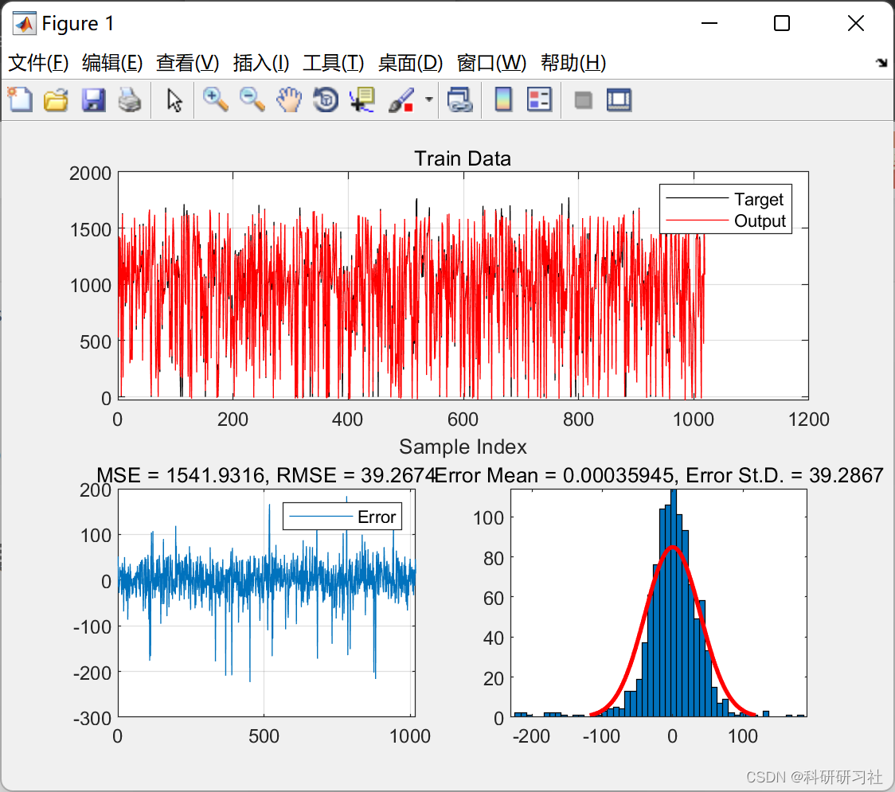
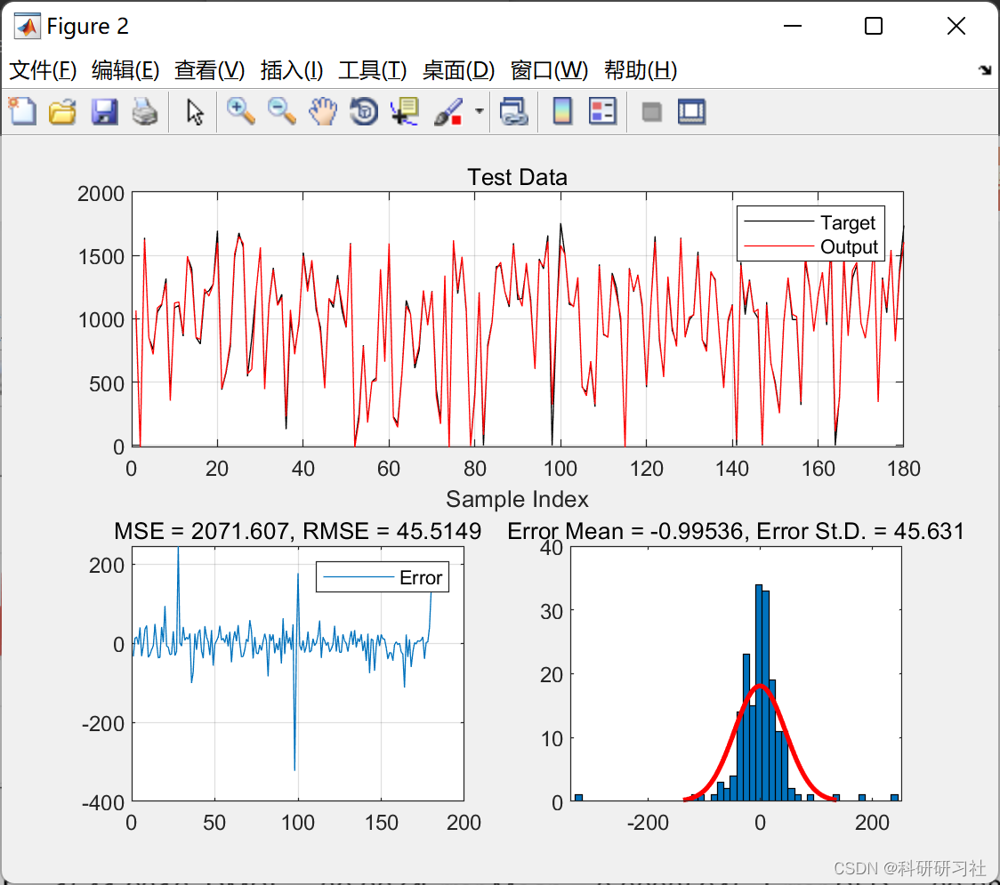
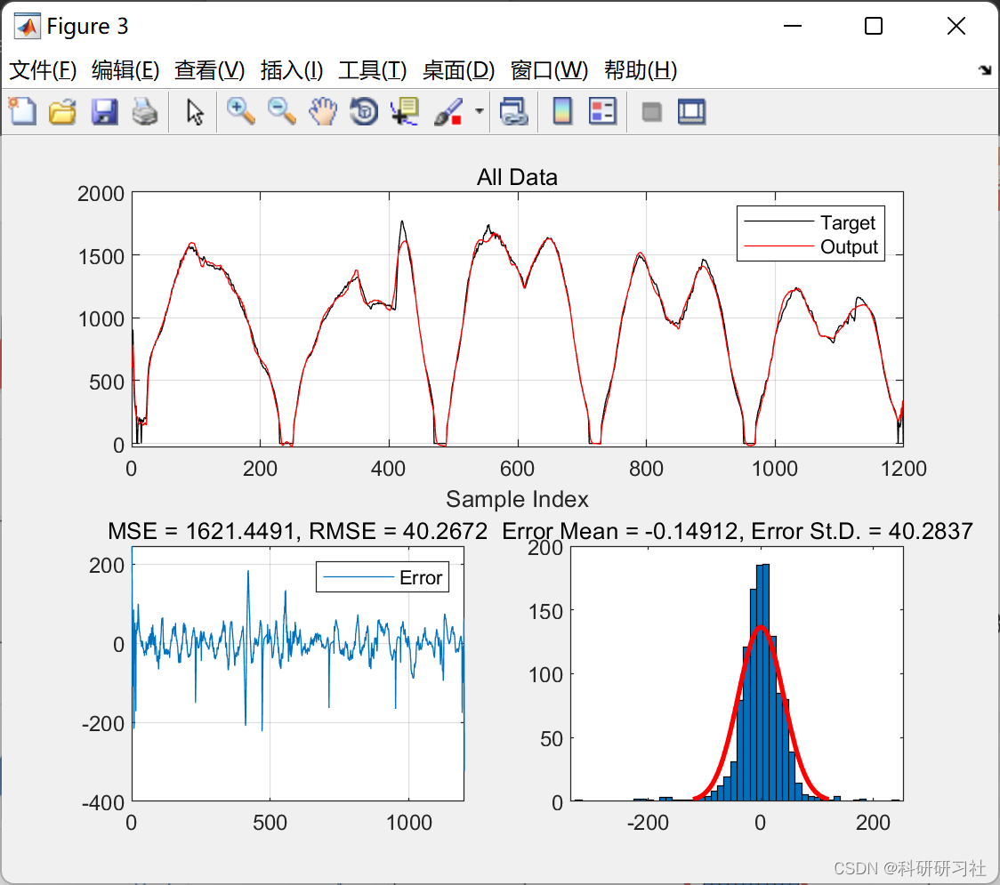
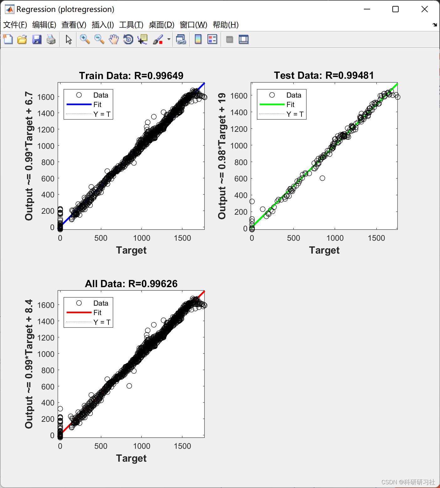
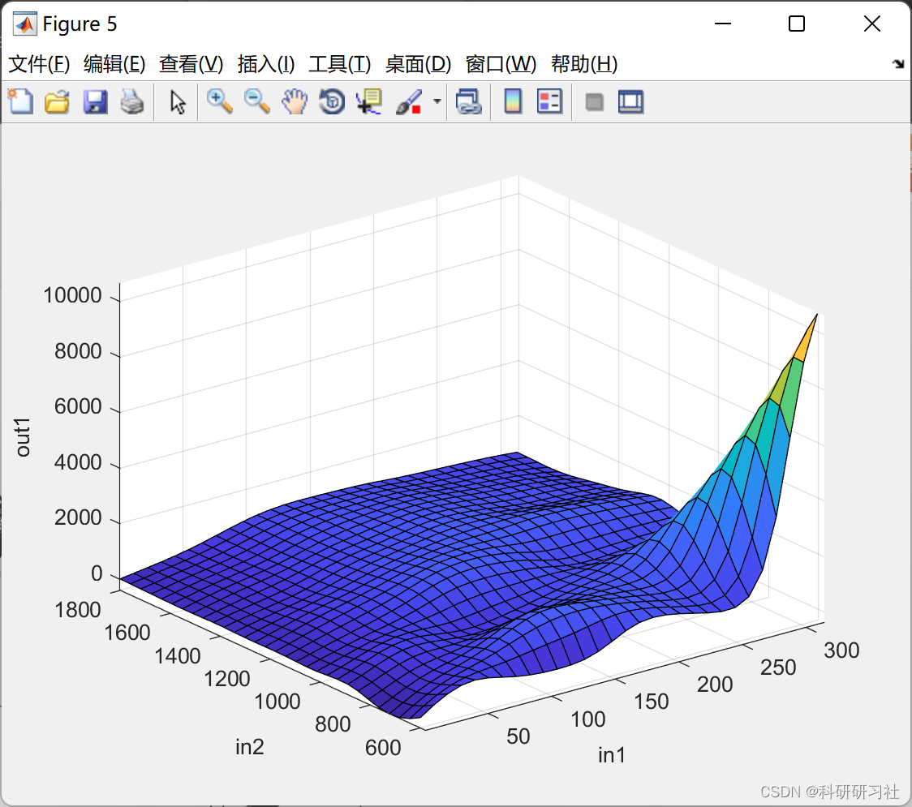

# Nonlinear Regression Based on ANFIS (Matlab Code Implementation)

1. Overview introduces the architecture and learning process of ANFIS (Adaptive Network-Based Fuzzy Inference System), which is a fuzzy inference system realized under the framework of an adaptive network. By employing a hybrid learning process, the proposed ANFIS can construct input-output mappings based on human knowledge (in the form of fuzzy if-then rules) and predefined input-output data pairs. In simulations, the ANFIS architecture is used to model nonlinear functions, identify nonlinear components in online identification control systems, and predict chaotic time series, all of which yield significant results. The comparison with artificial neural networks and early work on fuzzy modeling are listed and discussed. It also suggests other extensions for the proposed ANFIS and promising applications in automatic control and signal processing.
Detailed article can be found here: https://ieeexplore.ieee.org/xpl/articleDetails.jsp?arnumber=256541
2 Matlab code implementation only showcases part of the code, all codes can be accessed by clicking the link below:
Nonlinear Regression Based on ANFIS (Matlab Code Implementation)
clc;\nclear;\nclose all;\n\n%% Creating time series data\n\ndata = load('engine_data');\n\n% Introduction to the dataset\n% Input:\n%     1. Fuel Consumption Rate\n% 2. Speed\n% Objective:\n%     1. Torque\n% 2. Nitrous Oxide Emissions\n\nInputs = data.Inputs';\nTargets = data.Targets';\n\nnData = size(Inputs,1);\n\nTargets = Targets(:,2); % Select the first output model\n%% Switch data\n\nPERM = randperm(nData); % Randomly arrange data\n\npTrain=0.85;\nnTrainData=round(pTrain*nData);\nTrainInd=PERM(1:nTrainData);\nTrainInputs=Inputs(TrainInd,:);\nTrainTargets=Targets(TrainInd,:);\n\npTest=1-pTrain;\nnTestData=nData-nTrainData;\nTestInd=PERM(nTrainData+1:end);\nTestInputs=Inputs(TestInd,:);\nTestTargets=Targets(TestInd,:);\n\n%% Selection of FIS generation method\n\nOption{1}='Grid Partitioning (genfis1)';\nOption{2}='Subtractive Clustering (genfis2)';\nOption{3}='FCM (genfis3)';\n\nANSWER=questdlg('Select FIS Generation Approach:',...\n                'Select GENFIS',...\n                Option{1},Option{2},Option{3},...\n                Option{3});\npause(0.01);\n  
3. Running Results Editing
Editor
Editor
Editor
4 Conclusions Fuzzy control is the most successful application of fuzzy set theory and fuzzy inference systems to date. Due to ANFIS's adaptive capability, its applications in adaptive control and learning control are immediate. Most importantly, it can replace almost all neural networks in a control system to achieve the same objectives. For example, Narendra's pioneering work on using neural networks for adaptive control [32] can be similarly realized with ANFIS. Additionally, the four general designs of neural networks proposed by Werbos [9], [62] (i.e., supervisory control, direct reversal control, neuro-adaptive control, and utility backpropagation) are also directly applicable schemes for ANFIS.Particularly, we have adopted a similar approach to implement self-learning fuzzy controllers with four rules through time-reversed backpropagation [33] or real-time expansion methods, achieving near-optimal balance in the inverted pendulum [12]. It is anticipated that advancements in neural network technology in control will also promote progress in ANFIS, and vice versa. The positive role of neural networks in signal processing [64] and [21] also suggests analogous applications for ANFIS. The nonlinear and structured knowledge representation of ANFIS is a major advantage over classical linear methods in adaptive filtering [8] and adaptive signal processing [63], such as recognition, inverse modeling, predictive coding, adaptive channel equalization, and adaptive interference cancellation (noise or echo).
5. References https://ieeexplore.ieee.org/xpl/articleDetails.jsp?arnumber=256541

## Images

<!-- PAYMENT_BLOCK -->

## Get this dataset

- Payment link (Stripe): [Buy now](https://buy.stripe.com/3cs8yP7sY87d0vu9AB)
- Payment QR code: 

<!-- /PAYMENT_BLOCK -->
